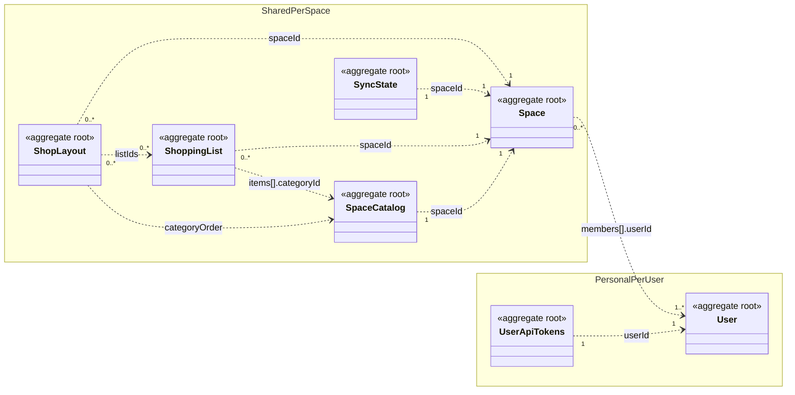
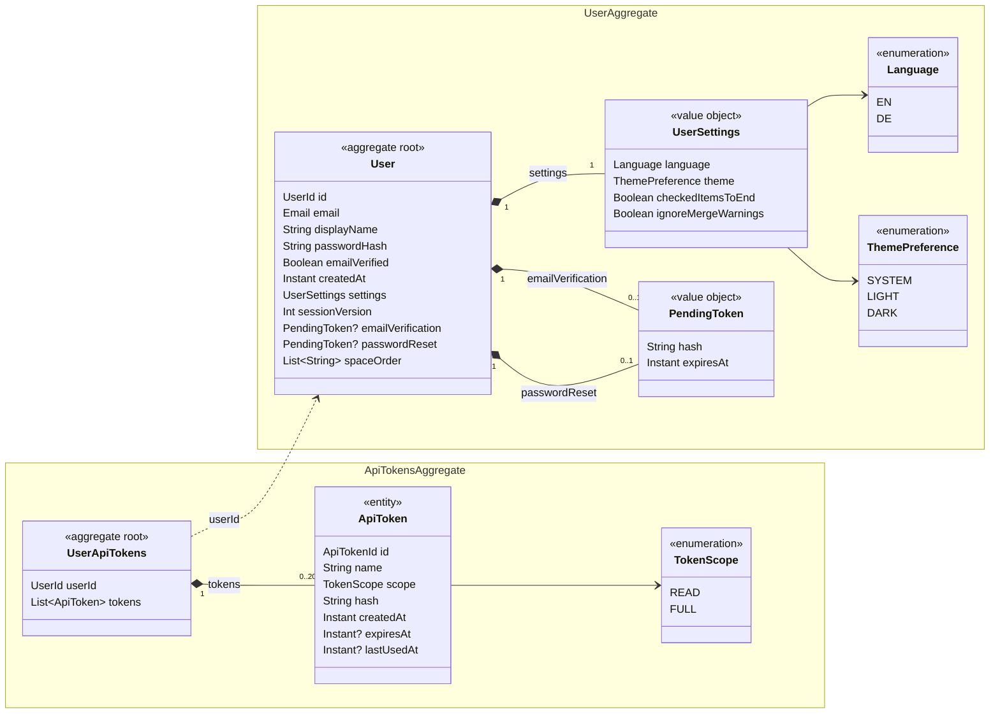
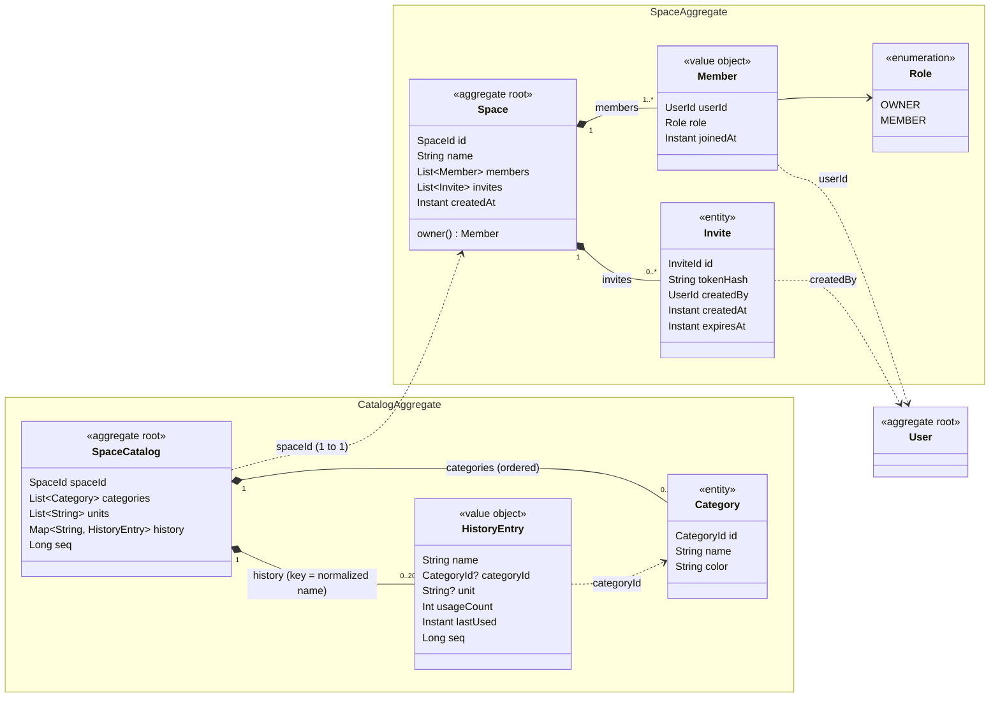
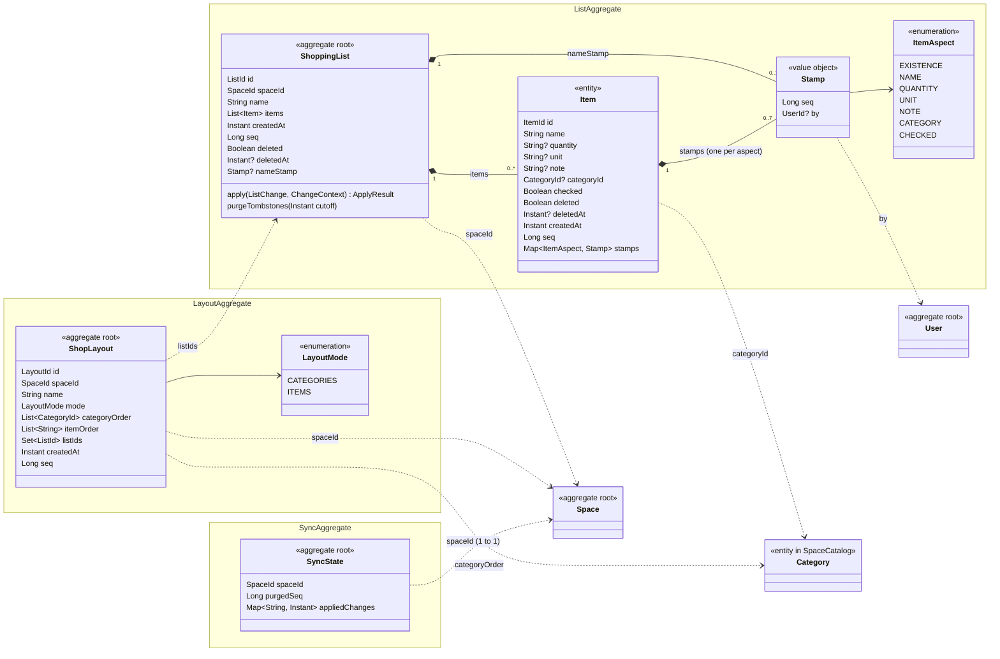
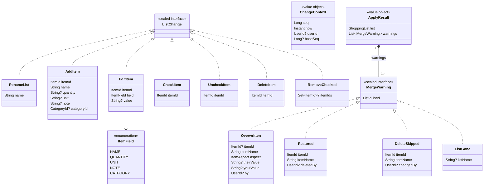

# Domain data model

The domain model of the backend (`backend/src/main/kotlin/com/tfassbender/shoppinglist/domain/`), drawn as
Mermaid class diagrams. It shows the aggregates, what lives inside them and how they reference each other.
Source of truth is the code; this document explains it.

**How to read the diagrams**

- One `namespace` box per aggregate. `<<aggregate root>>` marks the root; entities (with their own id)
  and `<<value object>>`s (no identity) live inside; `<<enumeration>>` for enums.
- Solid diamond (`*--`) = composition inside an aggregate, with cardinalities.
- Dashed arrow (`..>`) = reference **by id** to another aggregate (or to an entity inside one),
  labelled with the id field. There are no object references across aggregates.
- Typed ids (`UserId`, `SpaceId`, `ListId`, `ItemId`, `CategoryId`, `LayoutId`, `InviteId`, `ApiTokenId`)
  are `@JvmInline value class`es wrapping a `String`; they appear only as field types.
- `?` marks a nullable field. Only the fields that explain the model are shown; most methods are left out.

## 1. Overview

Eight aggregates in two groups: data that belongs to a **space** (shared by all its members) and data
that belongs to a **user** (personal, never shared).

| Aggregate root | Responsibility | Scope | PostgreSQL tables | File (under the data dir) |
|---|---|---|---|---|
| `Space` | Members with roles, invite links | shared | `spaces`, `space_members`, `space_invites` | `spaces/<spaceId>/space.json` |
| `SpaceCatalog` | Categories, units, item history | shared, 1 per space | `catalogs`, `catalog_categories`, `catalog_units`, `item_history` | `spaces/<spaceId>/catalog.json` |
| `ShoppingList` | One list and its items, merge rules | shared | `shopping_lists`, `items`, `item_stamps` | `spaces/<spaceId>/lists/<listId>.json` |
| `ShopLayout` | Walking order through one shop | shared | `shop_layouts`, `layout_category_order`, `layout_item_order`, `layout_lists` | `spaces/<spaceId>/layouts/<layoutId>.json` |
| `SyncState` | Idempotency of change ids, tombstone purge horizon | shared, 1 per space | `sync_states`, `sync_applied_changes` | `spaces/<spaceId>/sync.json` |
| `User` | Account, credentials, settings, order of the user's spaces | personal | `users`, `user_space_order` | `users/<userId>/user.json` |
| `UserApiTokens` | The user's API tokens for AI agents/scripts | personal, 1 per user | `api_tokens` | `users/<userId>/api-tokens.json` |

Not an aggregate but part of the stored state: the **space sequence counter** (table `space_sequences`,
file `spaces/<spaceId>/sequence.json`). It sits behind the application port `SequenceCounter`, not in the
domain; see [Sync fields](#6-how-the-sync-fields-fit-together).

Which storage is used is set by `shoppinglist.storage` (`postgres` or `file`, see `doc/tech_stack.md` →
Persistence). All changes to a space's data run under one in-process lock per space, and with Postgres in
one transaction per locked operation. The schema is `backend/src/main/resources/db/migration/V1__initial_schema.sql`;
JPA entities live in `adapter/persistence/jpa/`, file DTOs (with a `schemaVersion`) in `adapter/persistence/`.
Files are written atomically (temp file + move).

## 2. Users and authentication (personal)

**`User`** – a registered account.
- `email` is the value object `Email` (trimmed, lowercase, syntactically valid); it is the login name.
- `displayName`: 1–40 characters, no surrounding spaces.
- Only hashes are stored: BCrypt for the password, SHA-256 for the single-use email-verification and
  password-reset tokens (`PendingToken`, with expiry).
- `sessionVersion` is embedded in every issued JWT. Incrementing it (password change/reset, "log out
  everywhere") invalidates all earlier sessions.
- `spaceOrder`: ids of the user's spaces in the order the user chose (personal - members of a shared
  space sort differently). Plain strings, because `domain.space` already depends on `domain.user`; ids of
  spaces left or deleted meanwhile are ignored and dropped on the next reorder.
- `settings` are personal preferences that apply on every client (web, Android). The `language` also picks
  the default categories and units of a space the user creates (`CatalogDefaults`).

**`UserApiTokens`** – all API tokens of one user, one file per user. The docs call this aggregate
"`ApiToken`"; in the code the root is the collection `UserApiTokens` and `ApiToken` is an entity in it.
- At most 20 tokens per user; tokens are revoked by id.
- Only the hash of the random token is stored. `expiresAt = null` means "never expires".
- `READ` scope allows only reading requests; `FULL` allows everything the user may do except managing
  the account and tokens.

## 3. Spaces and catalog (shared per space)

**`Space`** – the unit of sharing. Lists, layouts, the catalog and the sync state belong to a space.
- Exactly one member has the role `OWNER`, and no user is a member twice (checked in `init`).
- The owner can't leave or be removed; ownership has to be transferred first.
- Invites are single-use, expire, and only the token hash is stored. Accepting one consumes it. If the
  user is already a member, the invite stays valid so it can be passed on. Expired invites are dropped.
- When an account is deleted and the user owned the space, ownership passes to the longest-standing
  member. If nobody is left, the space is deleted.
- Who may call which operation (owner vs. member) is checked in the application services, not here.

**`SpaceCatalog`** – categories, units and item history of a space; one aggregate because they are small.
- Categories are ordered, at most 100, with a `#RRGGBB` color and a name of 1–40 characters. A reorder must
  contain every category exactly once.
- Deleting a category clears it from the history. Items and layouts keep the id, and items show up as
  uncategorized.
- Units: at most 50, each 1–20 characters, deduplicated ignoring case.
- History: keyed by normalized item name. It remembers the last category and unit (for automatic placement
  and autocomplete) and a usage count (incremented on check, for "most used first"). At most 2000 entries;
  beyond that the least used are forgotten. Renaming onto an existing name merges both entries.
- New spaces start with default categories and units in the creator's language (`CatalogDefaults`). The
  category ids are readable keys such as `dairy`.

## 4. Lists and shop layouts (shared per space)

**`ShoppingList`** – one list with its items. Every mutation goes through `apply(ListChange, ChangeContext)`,
so online REST calls, offline sync batches and AI agents share one implementation, including the merge
rules (`doc/features.md` 3.5):
- Same field changed concurrently: the later applied change wins (`Overwritten` warning).
- Edit, check or uncheck of a deleted item: the item is restored, because edit wins over delete
  (`Restored`).
- Delete of an item someone else changed concurrently: the item stays (`DeleteSkipped`).
- "Concurrently" means after the author's `baseSeq` and by another user.

Other rules:
- List name 1–60 characters. Item name 1–100. `quantity` and `unit` up to 20, `note` up to 200 characters.
- At most 1000 active items; tombstones don't count. Item ids are client-generated and unique per list.
- Ids that clients generate (`ListId`, `ItemId`, `CategoryId`, `LayoutId`) must match
  `[A-Za-z0-9_-]{1,64}`, because they become file names and URL segments.
- A deleted list stays as a tombstone (`deleted = true`) and rejects every further change.

**`ShopLayout`** – the walking order through one shop.
- It keeps both orders, so switching the mode loses nothing:
  - `categoryOrder` for mode `CATEGORIES`, the default: new items are placed automatically.
  - `itemOrder` for mode `ITEMS`: item names matched case-insensitively, unique, at most 1000.
- Lists and layouts are many-to-many. Only the layout side stores the link (`listIds`).
- `copyAs` creates a second shop of the same chain with the same orders and lists.
- `ItemSorter` is a pure domain function that sorts a list's items for a layout, in this order:
  1. checked items last, if the user wants that,
  2. position in the layout,
  3. usage count from the history,
  4. name, then creation time.

**`SyncState`** – sync bookkeeping of a space, explained in the next sections.

## 5. Changes and merge results (not persisted)

The commands a client sends to change a list, and what the merge reports back. They live in the domain
because the merge is domain logic, but they are never stored. Offline clients send them in batches with
a change id.

- `EditItem` sets one field. Every field is its own change, so concurrent edits merge field by field.
  Each `ItemField` maps to an `ItemAspect` and has a maximum length.
- `RemoveChecked.itemIds` holds the items the author saw checked (offline). `null` means "all items that
  are checked right now".
- `ChangeContext.baseSeq` is the sequence number the author's client had seen. It is `null` for online
  calls, which then merge as plain "later wins" without warnings.

## 6. How the sync fields fit together

- **Space sequence counter** (`sequence.json`, port `SequenceCounter`): one increasing `Long` per space.
  Every change to the space's lists, layouts or catalog takes the next value.
- **`seq` on aggregates and parts**: the counter value of the last change.
  - `ShoppingList.seq` and `Item.seq` change on every change to the list or item.
  - `ShopLayout.seq` changes on every layout change.
  - `SpaceCatalog.seq` changes when clients have to take over the whole catalog: categories, units,
    removed or renamed history entries, or a history that got full.
  - `HistoryEntry.seq` changes when an entry is added or updated. Checking items does that all the
    time, and a pull then sends only those entries.

  `GET /api/spaces/{id}/changes?since=<seq>` returns everything with a newer `seq`, so no separate
  change log is needed. Deleting a layout only advances the counter, so clients notice and reload their
  layouts.
- **Tombstones**: a deleted item stays in the list with `deleted = true`, `deletedAt` and a new `seq`, so
  other clients learn about the deletion. Deleted lists are kept the same way.
- **Purging**: when a list is saved, item tombstones older than 30 days are dropped (`purgeTombstones`).
  The highest dropped `seq` raises `SyncState.purgedSeq`. A client whose `since` is below it (or `<= 0`,
  or above the current counter) must do a full resync (`SyncState.needsFullResync`).
- **Idempotency**: `SyncState.appliedChanges` remembers processed client change ids with their time, so
  a batch that is sent again is applied only once. Old entries are pruned by age, keeping at most 10,000.
- **Merge stamps**: `Item.stamps` holds one `Stamp(seq, by)` per `ItemAspect`, and `ShoppingList.nameStamp`
  does the same for the list name. A change conflicts with a stamp if `stamp.seq > baseSeq` and
  `stamp.by` is another user (`ChangeContext.isConcurrentForeign`). That check is all the merge rules
  need.

## 7. Observations

Things in the model that look inconsistent or surprising. They are recorded here, not fixed.

1. **The docs are behind the code.**
   - `CLAUDE.md` and `doc/tech_stack.md` name the aggregate `ApiToken`; in the code the root is
     `UserApiTokens`.
   - The docs don't mention the `SyncState` aggregate, `sync.json` or `sequence.json`.
   - `tech_stack.md` mentions a `version` field on the list for optimistic checks. It doesn't exist;
     `seq` covers that role.
2. **The `space` and `list` packages depend on each other.**
   - `CategoryId` is defined in `domain/list/ShoppingList.kt`, but categories belong to `SpaceCatalog` in
     `domain.space`, so `space` imports `list`.
   - `list` imports `space` (`SpaceId`, `SpaceCatalog.normalize`).
   - `ShopLayout` and `SyncState` are space-level aggregates but live in the `list` package.
3. **Some references point at an entity inside another aggregate.** `Item.categoryId`,
   `HistoryEntry.categoryId` and `ShopLayout.categoryOrder` reference `Category`, an entity inside
   `SpaceCatalog`, not an aggregate root. That is fine with id-only references, but these ids can dangle:
   deleting a category clears only the history. Items and layouts keep the id, and readers have to filter
   it out (as `ItemSorter` does).
4. **Several links are by name instead of by id.** `ShopLayout.itemOrder` and the `SpaceCatalog.history`
   keys use the normalized item name. Renaming an item, or renaming a history entry, doesn't carry over
   to layouts.
5. **Deleted lists and layouts are handled differently.**
   - A deleted list stays as a tombstone with `seq`. `purgeTombstones` drops only item tombstones, so a
     deleted list file seems to stay forever.
   - A deleted layout file is removed right away and leaves no tombstone. Only the advanced sequence
     counter tells clients about it.
6. **Stale references after a deletion.**
   - Deleting a list doesn't remove its id from `ShopLayout.listIds`; no cleanup is visible in the
     domain or the layout/list services.
7. **`Space` has no `seq`.** The space's own data (name, members, invites) isn't part of the
   sequence-based pull, unlike every other space-level aggregate.
8. **Only some ids are validated.** `UserId`, `SpaceId`, `InviteId` and `ApiTokenId` have no format check;
   the client-generated ids do. Server-generated ids make this reasonable, but `SpaceId` and `UserId`
   also become directory names. The persistence adapter guards path segments (`JsonFiles.safeSegment`),
   so this is a consistency point, not a hole.
10. **`HistoryEntry.seq` is lost on rename.** `SpaceCatalog.renameHistory` builds the merged entry without
    `seq` (back to 0). This is harmless only because `stampHistoryChanges` and the catalog-wide `seq`
    restamp it afterwards.
11. **`ShopLayout.copyAs` sets `seq = 0`** and depends on the service to overwrite it with the next
    counter value. Elsewhere, factories take `seq` as a parameter (`ShoppingList.create`).
